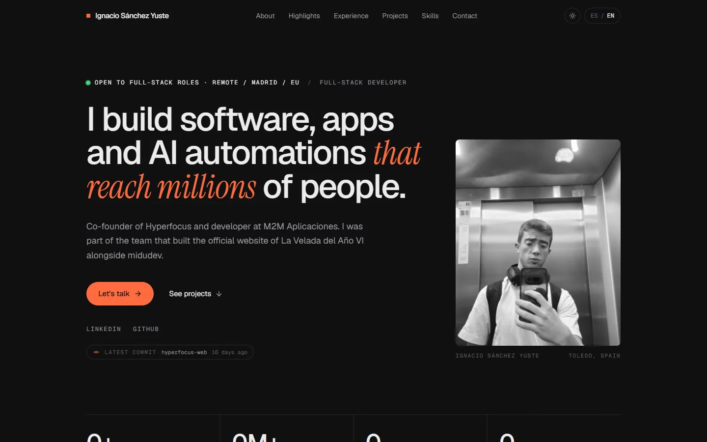

# Ignacio Sánchez Yuste — Portfolio

Personal site of **Ignacio Sánchez Yuste**, Full-Stack Developer, co-founder of [Hyperfocus](https://hyperfocus.es) and part of the team behind the official [La Velada del Año VI](https://infolavelada.com) website (1M+ visits in a month).

**Live:** [ignaciosanchezyuste.es](https://ignaciosanchezyuste.es)



## Features

- Spanish / English, English by default when the browser isn't in Spanish
- Dark and light themes (follows the system, remembers your choice, no flash on load)
- Prerendered HTML at build time, so search engines and CV parsers read real content
- Open Graph / Twitter cards, JSON-LD `Person` schema, `sitemap.xml` and `robots.txt`
- Featured projects written as mini case studies (problem → decisions → result)
- Live "latest commit" badge from the public GitHub API
- Animated stats, cursor spotlight on cards, scroll reveals (respects `prefers-reduced-motion`)
- Optional CV download button (shown only when the PDF exists)

## Stack

React 18 · Vite 7 · Tailwind CSS 3 · Radix UI · Lucide icons

## Getting started

```bash
npm install
npm run dev      # http://localhost:5173
npm run build    # client build + SSR prerender into dist/
npm run preview  # serve dist/
```

## Project structure

```
src/
├─ components/        # Page sections (Header, Highlights, Projects, …) and ui/ primitives
├─ context/           # Language provider
├─ hooks/             # useInView, useGithubActivity, spotlight handler
├─ i18n/translations.js  # All copy, ES + EN
├─ entry-server.jsx   # Render entry used by the prerender step
└─ main.jsx           # Client entry
scripts/prerender.mjs # Injects the rendered HTML into dist/index.html
public/               # Images, OG image, sitemap, robots, 404
```

## Editing content

- **Text:** `src/i18n/translations.js` (both languages).
- **Project screenshots:** drop a `.webp` in `public/img/projects/` and set `image` in `src/components/Projects.jsx`. Projects without one get a generated cover.
- **CV:** add `public/cv/CV-Ignacio-Sanchez-Yuste-ES.pdf` and `public/cv/CV-Ignacio-Sanchez-Yuste-EN.pdf`; the download buttons appear automatically.

## Deploy

`npm run build` and upload the contents of `dist/` to the web root.
